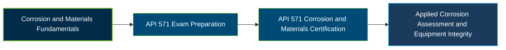

# API 571 Corrosion and Materials Certification Exam Guide

A dedicated study guide and technical reference repository for candidates preparing for the **American Petroleum Institute (API) 571 Corrosion and Materials Certification Exam**, focused on corrosion processes and damage mechanisms affecting fixed equipment.

---

## Exam Overview

The API 571 Corrosion and Materials certification validates knowledge of corrosion processes, material degradation, damage mechanisms, and methods used to identify, inspect, monitor, and mitigate equipment damage in the refining and petrochemical industries.

- **Exam Format**: Computer-based, proctored, closed-book examination with multiple-choice questions; available at designated test centers or through remote proctoring.
- **Target Audience**: Specialized inspectors, corrosion engineers, chemical engineers, and other professionals working in the petrochemical industry.
- **Prerequisites**: A current API 510, API 570, or API 653 certification provides automatic eligibility. Otherwise, relevant petrochemical industry experience is required, ranging from one year with a qualifying engineering degree to five or more years with no formal education.

---

## Core Exam Domains & Knowledge Areas

### 1. Terms, Definitions, and Acronyms

- Understand corrosion, materials, inspection, and damage-mechanism terminology.
- Recognize technical definitions and acronyms used in API RP 571.
- Interpret terminology in the context of equipment integrity and corrosion assessment.

### 2. Damage Mechanisms

- Identify each mechanism's description, affected materials, critical factors, and affected equipment or process units.
- Recognize damage appearance, morphology, and conditions that contribute to degradation.
- Understand prevention, mitigation, inspection, and monitoring approaches for applicable mechanisms.

---

## Certification Path

---

## Recommended Practice & Study Resources

Prepare for the API 571 examination by studying the official Body of Knowledge and strengthening your understanding of corrosion mechanisms, materials, and inspection practices.

- **CertsGate**: Explore [API 571 Corrosion and Materials exam preparation resources](https://certsgate.com/exams/api/api-571) for supplementary study materials and practice to review corrosion concepts and identify knowledge gaps.
- **AMPP Corrosion Resources**: Use the [AMPP Corrosion Basics reference](https://www.ampp.org/technical-research/impact/corrosion-basics) to reinforce corrosion fundamentals, common forms of corrosion, and prevention and mitigation concepts.
